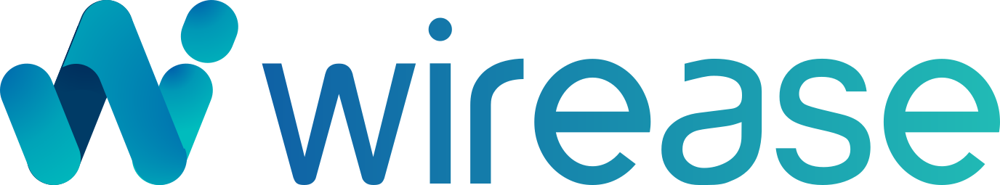

<p align="center">
  <a href="https://wirease.vercel.app">
    
  </a>
</p>

<h3 align="center">Send money from Hong Kong to 100+ countries — faster, easier and cheaper.</h3>

<p align="center">
  <a href="https://wirease.vercel.app"><strong>Live site →</strong></a>
</p>

<p align="center">
  
  
  
  
</p>

---

## About

The marketing homepage for **Wirease**, a Hong Kong–based cross-border payments company regulated by the Customs and Excise Department (C&ED), serving 100+ countries in 50+ currencies.

It covers the four lines of business:

| | |
|---|---|
| **Home remittance** | Send to family abroad at competitive rates |
| **Business payments** | Multi-currency payments for companies |
| **Wholesale banknotes** | 50+ currencies of physical banknotes |
| **IMTS platform** | Remittance infrastructure for partner brands |

## Highlights

- **Live calculator**: indicative HKD rates from [open.er-api.com](https://open.er-api.com) across 21 corridors, with static fallbacks.
- **Rotating globe**: a canvas orthographic projection with animated payment arcs, drag to spin.
- **Isometric Hong Kong**: a generated SVG city with traffic, a ferry and a payment route.
- **Scroll motion**: GSAP + ScrollTrigger reveals, odometer stats and a sticky solutions section.
- **No build step**: one `index.html`, CDN libraries, nothing to install.

## Brand

| Token | Hex | |
|---|---|---|
| Blue | `#0d61a6` |  |
| Teal | `#14bdb7` |  |
| Ink | `#21262b` |  |
| Mist | `#d2d6dc` |  |
| Paper | `#f9fafb` |  |

Typeface: [Archivo](https://fonts.google.com/specimen/Archivo).

## Run locally

```bash
python3 -m http.server 5173
```

Then open <http://localhost:5173>.

## Deploy

```bash
vercel deploy --prod
```

`vercel.json` tells Vercel to serve the files as a static site, with no build.

## Structure

```
index.html              the homepage (markup, styles, scripts)
assets/
  favicon.svg
  wirease-logo-horizontal.svg
  wirease-wordmark.svg
  hk-skyline.svg
vercel.json
```

---

<p align="center"><sub>© Wirease Limited · Hong Kong</sub></p>
